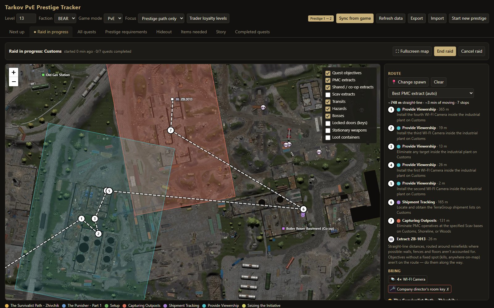
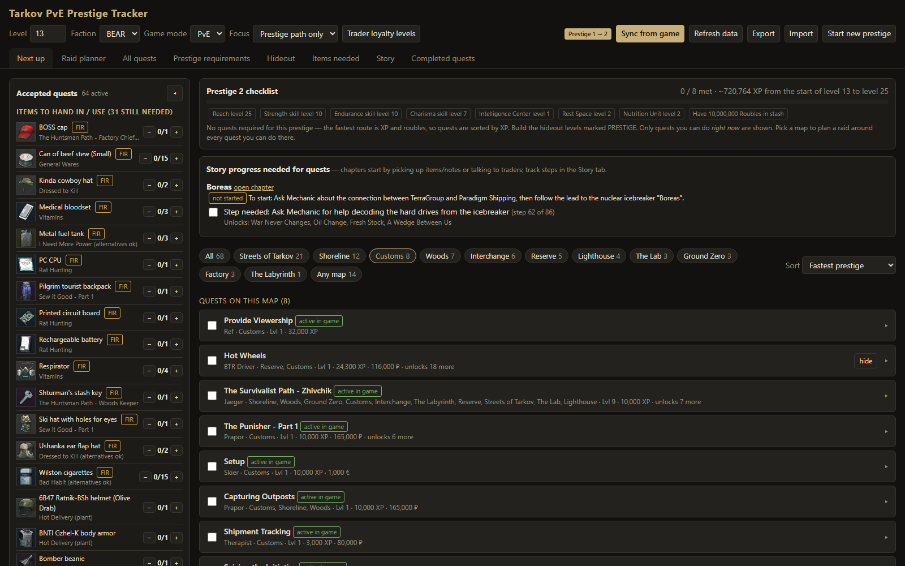
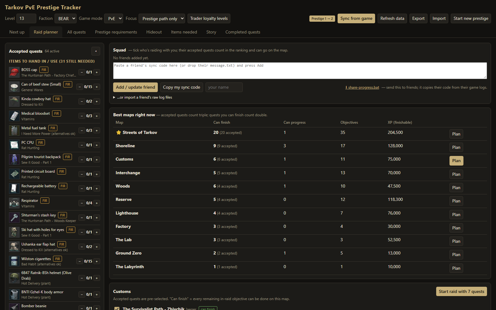
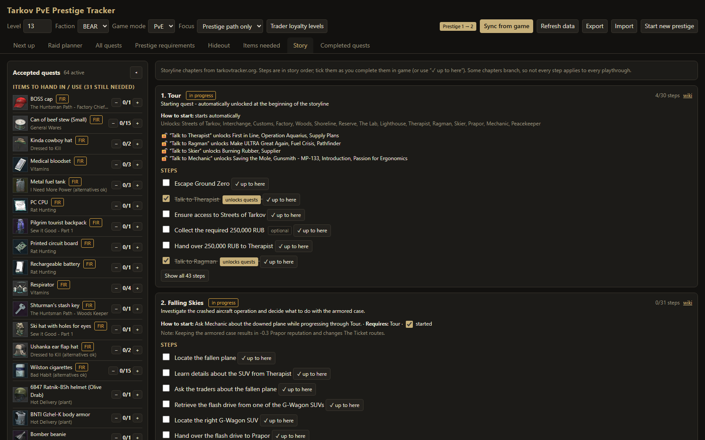

<div align="center">

# 🎯 Tarkov PvE Prestige Tracker

**Quests, hideout and raid planning for Escape from Tarkov PvE, built to get you through prestiges as fast as possible.**




</div>

---

## ✨ Features

| | |
|---|---|
| 🧭 **Next up** | Only the quests you can do *right now* (prerequisites, level, trader loyalty, story progress, and which traders and maps your Tour progress has unlocked), ordered for the fastest prestige: the required quest chain first, otherwise by XP. |
| 🔄 **Sync from game** | Reads quest start/finish/fail events straight from Tarkov's own log files (read-only) and keeps the tracker in step every minute. Detects prestige and wipe resets automatically. |
| 🗺️ **Raid planner** | Ranks every map by the quests you can finish there, then runs a live map with objective zones, extracts, transits, minefields, bosses, locked doors and loot. In raid, quests are split into *at a spot* and *anywhere on the map*, with pictures of the weapons and gear they require. |
| 🛣️ **Route planning** | Click where you spawned and get the shortest *walking* route through your objectives to the best extract: around walls and fences, up and down stairs, through doors (locked ones only with a key you have or pick up on the way), over ledges you can drop off, climb or vault, and around minefields. Every floor has its own view (Icebreaker's 16 decks, the Lab's levels, Reserve's bunkers…) with the walls of that floor, and a *Level transitions* layer marks the stairs, ramps, ladders and drops between floors. Quests that need a named exit or transit end the route there. |
| 🔑 **Keys & items** | A sidebar of everything your accepted quests need (FIR flags, counts, keys), and key checks next to each quest in the planner. Quests whose key you don't have start unticked, unless the key spawns on that map every raid: then the route picks it up first. |
| 🔎 **Key lookup** | Search any key: whether a quest or story chapter still needs it, its flea price, and what's behind the lock, rated from trash to high-value. |
| 🔧 **Gunsmith** | Pick a weapon and every attachment that fits it, and fits whatever it's mounted on, is combined: often 10<sup>30</sup>+ builds. Every ergonomics / vertical recoil value pair a conflict-free build reaches is plotted, with the best trade-offs highlighted. Click any point to see that exact build on a simulated modding screen: the attachment tree, each part's effect, and the totals, weight and price. Tick **Suppressed**, **Flashlight** or **Laser** (one combo device can count for both), pick a magazine size, require any part that fits, or pick a **Gunsmith quest**: its weapon and required parts are filled in, its limits are drawn on the plot, and *Meets quest* picks a build that passes them. Can't buy a part? Click ✕ on it to leave it out of every build (saved with your progress). |
| 🧭 **Profile setup** | One step-by-step form (☰ Menu) for everything the logs can't tell: level, trader loyalty and reputation, skills, hideout, story progress, stash and keys. |
| 👥 **Squad sync** | Friends share their progress as a sync code from their own tracker, or by sending their raw log files, so you can plan raids around everyone's quests. |
| 🏆 **Prestige, hideout & story** | Prestige checklists, the hideout levels you need (with prerequisites), and every storyline chapter with how to start it. |

## 📸 Screenshots

<table>
<tr>
<td width="50%"><p align="center"><b>Next up</b>: what to do now, with the accepted-quest items sidebar</p></td>
<td width="50%"><p align="center"><b>Raid planner</b>: best maps right now</p></td>
</tr>
<tr>
<td width="50%"><p align="center"><b>Story</b>: chapters, how to start them, step checklists</p></td>
<td width="50%"><p align="center"><b>Raid in progress</b>: planned route and map layers</p></td>
</tr>
</table>

## 🚀 Quick start

1. Install [Node.js](https://nodejs.org) 18 or newer. No npm packages are needed.
2. Download this repo (**Code → Download ZIP**) and unzip it anywhere.
3. Double-click **`start-tracker.bat`**. The tracker opens at <http://localhost:4747>.
4. Press **Sync from game** (or let it sync on its own), then open **☰ Menu → Set up my profile** and step through level, traders, skills, hideout, story and keys: the things the game logs don't record.

> [!TIP]
> Your progress lives in your browser's local storage. Use **☰ Menu → Export progress** now and then to keep a backup file.

Prefer a terminal? `node server.js --open`

### 🐳 Docker

To keep Node and Python off your PC, run it with [Docker Desktop](https://www.docker.com/products/docker-desktop/) instead:

1. Copy `.env.example` to `.env` and set `TARKOV_DIR` to your game folder (the one with `EscapeFromTarkov_Data`).
2. Double-click **`start-tracker-docker.bat`**, or run `docker compose up -d --build`. The tracker opens at <http://localhost:4747>.

The game folder is mounted read-only, and the tracker only reads its `Logs` (set `TARKOV_LOGS_DIR` in `.env` if they're elsewhere, e.g. `build/Logs` on some Steam installs). Downloaded data goes to `cache/` and the meshes are read from `navmesh/`, both in this folder.

## 🔄 How game sync works

Tarkov writes every quest event to its logs:

```
<Tarkov>\Logs\log_YYYY.MM.DD_HH-MM-SS_<version>\
    … push-notifications_000.log   ← quest started / failed / finished
    … application_000.log          ← PvE or PvP session
```

The tracker only **reads** these files on your PC, and only quest IDs and timestamps are used. Nothing touches the game, its memory or its network traffic. The game folder is found automatically for BSG launcher and Steam installs (including extra Steam libraries), or a `Battlestate Games` folder on any drive. If yours isn't found, set the `TARKOV_LOGS` environment variable to your `Logs` folder.

## 🧱 Walking routes (navmesh)

Routes are planned on a walkable mesh of each map built from the game's own files on your PC, so they follow the real walls, floors and stairs:

1. **Collision geometry**: every collider the player collides with (per the game's physics layer matrix: terrain, low-poly colliders, invisible level borders), from every scene the map loads. Interactive doors are left open and marked; locked ones (key or keycard) only open for keys you have or pick up on the route. Gates that never open stay shut.
2. **Recast** turns that into a navmesh for a player-sized capsule (0.3 m radius, crouch height, 0.45 m steps, 50° slopes) on 10 cm voxels, the same algorithm Unity uses for the bots.
3. **Movement links** where the mesh has a ledge: drops (up to 2.4 m, no fall damage), climbs (up to 1.5 m) and vaults over low obstacles. Each is checked with rays against the collision geometry.

It's checked against the bots' own navmesh (walking distances agree to a median 0.93–1.00) and tarkov.dev's positions: every spawn on every map is on the mesh. Quest spots and extracts behind locked doors, or on a ledge you can't walk to, route to the nearest place you can reach, and the route says which key would open the way.

**Quest locations** come from tarkov.dev, checked against the game's own quest triggers: of 533 zones with the same id in both, all sit at the same spot (median 0.00 m). Objectives tarkov.dev has no position for are filled from the game files (`tools/extract_zones.py` → `tools/build_quest_locations.js` → `data/quest-locations.json`): interactive quest spots name the objective they complete, e.g. *Wiring the Vessel*'s three repairs on Icebreaker. Boss kills route to the boss's spawn spots. Every in-raid objective that has a place now has an exact spot; only "anywhere on the map" kills and extracts don't.

**After a game patch** json.tarkov.dev (and tarkovtracker.org's corrections) can lag the game by days, while the wiki is usually updated within hours. `python tools/quest_wiki_check.py` lists quests whose wiki objectives name other maps than tarkov.dev, newest edit first, with both texts side by side. Real changes go into `data/quest-overrides.json` (objective id → new description, count and/or maps, applied once marked `verified`); the quest shows an "updated for patch" badge. Patch 1.3.0 (29 Oct 2026) moved *Job for a Patriot* from Lighthouse/Customs/Reserve to Streets of Tarkov, Shoreline and Ground Zero.

The built meshes live in `navmesh/`. Build them once, and again after a game update. With Docker everything the build needs (Python with UnityPy, Node with Recast) lives in the `navmesh` image:

```
docker compose run --rm --build navmesh            # every map
docker compose run --rm navmesh customs factory    # just these
```

Without Docker, it needs Python with `UnityPy numpy pillow` and `npm install recast-navigation` somewhere:

```
PY=<python> RECAST_DIR=<folder with node_modules/recast-navigation> tools/build_all.sh "<game folder>"
```

A full build takes a while and several GB of RAM per map (lower `JOBS` in `.env` if Docker runs out of memory; Docker Desktop gets half your RAM by default). Logs are in `navmesh/logs/`. Without `navmesh/` files the planner falls back to straight lines.

## 🔧 How the gunsmith solves a weapon

Listing builds is hopeless: an M4A1 has about 10<sup>37</sup> attachment combinations. Ergonomics and recoil modifiers simply add up over everything installed, though, so `gunsmith.js` works with the *set of reachable values* instead. A slot's set is the union of its options' sets (plus "empty" unless the slot is required); a part's set is its own stats plus one point from each of its slots. Points are kept in buckets of half an ergonomics point and half a percent of recoil.

Some parts can't go together: a long handguard on a short barrel, two scopes on one rail, two stocks. Each way of reaching a point carries a fingerprint of the conflict-prone parts it uses, and two partial builds are only added together when they don't clash. Every point keeps up to six differently-fingerprinted ways. So every plotted point has a real conflict-free build, and clicking it rebuilds that build exactly by following the recorded choices. A point can only be missed when its bucket runs out of fingerprint room.

**Excluded parts** (ones you can't get) are simply left out of every slot, along with whatever only fits on them; a required slot left with no options makes its part unusable.

**Required parts** (a quest's parts, any suppressor, a visible flashlight or laser, a magazine of 60+ rounds or of exactly 30) work the same way: each requirement gets a bit, every way carries the bits its parts meet, and only points that meet them all are plotted. A slot that every suppressor sits under (on an AR-15: receiver, barrel, muzzle) drops the ways without one straight away, so requirements make solving faster, not slower: every Gunsmith quest build solves in under a second, except the suppressed M4A1 (~10 s). Flashlights and lasers fit on nearly any rail, so they prune less: an AR-15 with flashlight, laser and suppressor all required takes ~40 s. Which devices have a *visible* light or laser isn't in the data, so it comes from the wiki (`data/tactical-devices.json`; IR-only devices don't count). Quest limits on the *recoil sum* (vertical + horizontal, which scale together) become a vertical recoil line on the plot, and each point comes with its build's weight so *Meets quest* also respects weight limits. `tools/gunsmith_quest_check.js` solves all 30 Gunsmith quest builds and verifies every returned build; `tools/ui_gunsmith_needs_test.mjs` checks the quest picker, Suppressed and the part search in the browser, and `tools/ui_gunsmith_exclude_test.mjs` the Flashlight / Laser toggles, magazine size and exclusions.

Solving runs in a worker thread (AR-15 platforms take ~13 s, most weapons under 2 s), and the last four solves stay in memory. The weapon and attachment catalogue (`cache/gunsmith-<mode>-v3.json`) is rebuilt from json.tarkov.dev's items every 6 hours. Ergonomics are shown as the raw sum. `tools/ui_gunsmith_test.mjs` drives the tab end to end in headless Edge and checks that the clicked point and the build's totals match.

## 👥 Raiding with friends

Two ways to get a friend's progress into your Squad panel (Raid planner tab):

- **They run the tracker too:** they press **Copy my sync code** and paste it to you.
- **They don't:** they zip their `push-notifications` and `application` logs (Explorer search in the `Logs` folder → select all → *Send to → Compressed folder*) and send you the zip, which you drop into the Squad panel. The zip is read in your browser.

Either way, nobody has to run a script or program someone else sent them.

## ⚠️ Good to know

- **Unlock data isn't perfect.** Tarkov 1.x unlocks many quests through server-side story and progress flags. The tracker combines several community sources and your own logs. For anything the data gets wrong, use **hide** on a quest; it reappears by itself once the game shows you accepted it.
- **Quests you'll never do:** mark them **won't do**. They drop out of every list for good (kept across prestiges) until you undo it from *All quests → show won't do*.
- **Routes need the navmesh files.** Without `navmesh/<map>.bin` (built from your game install, see above) routes fall back to straight lines that ignore walls and floors.
- **Your stash isn't visible.** Item and key counts are entered by you.

## 🙏 Data sources & credits

- [**tarkov.dev**](https://tarkov.dev) / [the-hideout](https://github.com/the-hideout): quest, hideout, map and item data ([json.tarkov.dev](https://json.tarkov.dev)), plus the interactive map definitions and tiles.
- [**TarkovTracker**](https://tarkovtracker.org): community corrections for quest unlocks and storyline chapters (unofficial internal feed, used optionally).
- [**Escape from Tarkov Wiki**](https://escapefromtarkov.fandom.com): loyalty-level requirements missing from the other sources.
- [**TarkovMonitor**](https://github.com/the-hideout/TarkovMonitor): the approach for reading quest events from game logs.
- [**Leaflet**](https://leafletjs.com): the map engine.

## 🗂️ Project layout

| File | Purpose |
|---|---|
| `index.html` | The whole tracker UI (single page, vanilla JS) |
| `server.js` | Local server: serves the page and builds the combined game data (cached 6 h) |
| `gamelogs.js` | Reads quest progress from the game's log files |
| `gunsmith.js` | Weapon / attachment catalogue and the solver behind the Gunsmith tab (runs in a worker thread) |
| `start-tracker.bat` | Starts the server and opens your browser |
| `start-tracker-docker.bat`, `docker-compose.yml`, `Dockerfile` | The same in Docker, plus the `navmesh` build image (`docker/navmesh/` pins its Python and npm packages) |
| `data/` | Local fixes laid over the downloaded data: quest spots from the game files, floors and extracts tarkov.dev lacks, level transitions per map, and objectives a patch changed before tarkov.dev caught up (`quest-overrides.json`) |
| `tools/` | Builds the navmesh, quest zones and level transitions from your game install |

---

<div align="center"><sub>Unofficial fan project. Not affiliated with or endorsed by Battlestate Games. Escape from Tarkov is a trademark of Battlestate Games.</sub></div>
